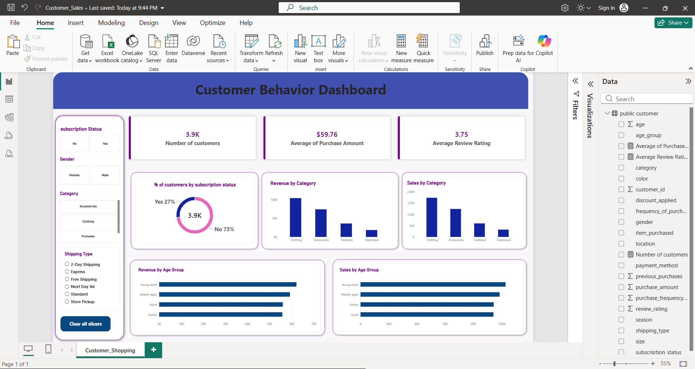

# 👨🏻‍💻 Customer Behavior Data Analyst Portfolio Project

## 📌 Project Overview

This project demonstrates an end-to-end data analytics workflow using Python, SQL, PostgreSQL, and Power BI.

The objective is to analyze customer shopping behavior, identify purchasing patterns, understand customer loyalty, and generate meaningful business insights that can support data-driven decision-making.

This project covers the complete data analytics process, from raw data preparation to business reporting and visualization.

## 🎯 Project Objectives

- Clean and transform raw customer data.
- Perform Exploratory Data Analysis (EDA) using Python.
- Analyze customer transactions and purchasing behavior using SQL.
- Identify customer segments and loyalty patterns.
- Develop an interactive Power BI dashboard.
- Generate actionable business recommendations.

## 🛠️ Tools and Technologies

| Tool | Purpose |
|---|---|
| Python | Data analysis and preprocessing |
| Pandas | Data manipulation |
| NumPy | Numerical analysis |
| Jupyter Notebook | Python development |
| PostgreSQL | Database management |
| pgAdmin 4 | SQL query execution |
| Power BI | Dashboard and visualization |

## 🔄 Project Workflow

### 1. Data Preparation and EDA – Python
- Imported and explored the raw dataset.
- Checked missing values and duplicate records.
- Cleaned and transformed the data.
- Performed exploratory data analysis to identify patterns.

### 2. SQL Analysis – PostgreSQL
- Created and managed the database.
- Loaded the prepared customer data.
- Wrote SQL queries to analyze customer behavior.
- Extracted insights about customer segments, loyalty, and purchasing trends.

### 3. Data Visualization – Power BI
- Connected the database to Power BI.
- Developed an interactive dashboard.
- Presented important business metrics and customer insights.
- Visualized customer purchasing patterns and trends.

## 📊 Power BI Dashboard

Dashboard screenshot below:

## 💡 Key Business Insights

The analysis aims to identify:
- Customer purchasing patterns.
- Customer segments and loyalty trends.
- Product and category performance.
- Factors influencing purchasing decisions.
- Opportunities to improve customer engagement and retention.

## 📈 Business Recommendations

Based on the analytical findings, provide recommendations to improve customer satisfaction, strengthen customer loyalty, and support business growth.

## 👩‍💻 Skills Demonstrated

Python | SQL | PostgreSQL | Pandas | NumPy | Power BI | Data Cleaning | EDA | Data Visualization | Business Intelligence | Business Analysis
